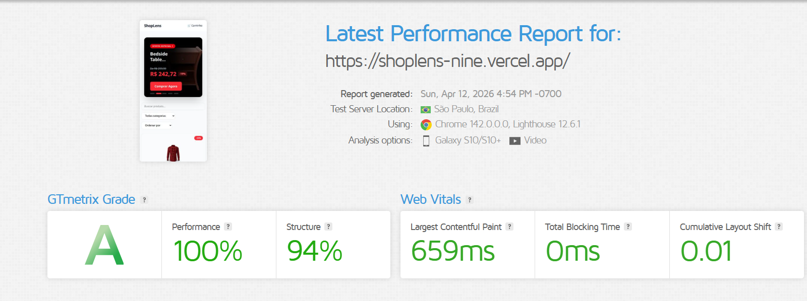

# ShopLens: React E-commerce

A fast, modern e-commerce front-end built with React 18, Vite, TypeScript, Zustand, React Query and Tailwind CSS. It is a practical example of a scalable, feature-based architecture with a focus on performance.

**Live demo:** https://shoplens-nine.vercel.app



## Features

- **Product listing** with pagination and infinite scroll.
- **Live search** with debounce to reduce API calls.
- **Shopping cart** with persistent global state.
- **Responsive design** for desktop, tablet and mobile.
- **Performance work:**
  - Lazy-loaded images
  - List virtualization (only visible items are rendered)
  - Component memoization to avoid unnecessary re-renders
  - API caching with React Query

## Tech stack

| Area | Technology |
|---|---|
| Framework | React 18 |
| Build tool | Vite |
| Language | TypeScript |
| Styling | Tailwind CSS |
| State | Zustand |
| Data fetching and cache | TanStack React Query |
| API | [DummyJSON](https://dummyjson.com/) |

## Architecture

Feature-based: logic, components and hooks are grouped by feature (`products`, `cart`), which keeps coupling low and makes the codebase easier to scale.

```
src/
├── features/
│   ├── products/   # product listing, search, infinite scroll
│   └── cart/       # cart UI and logic
├── shared/
│   ├── api/        # API access layer
│   ├── hooks/      # reusable hooks
│   ├── types/      # domain types
│   └── utils/      # pure helpers
├── store/          # global stores (Zustand)
├── App.tsx
└── main.tsx
```

## Getting started

Requirements: Node.js 18+ and pnpm (or npm/yarn).

```bash
git clone https://github.com/theussoares/react-ecommerce.git
cd react-ecommerce
pnpm install
pnpm dev        # http://localhost:5173
```

## Scripts

| Command | Description |
|---|---|
| `pnpm dev` | Start the Vite dev server |
| `pnpm build` | Production build |
| `pnpm preview` | Preview the production build |
| `pnpm lint` | Run ESLint |

## Contributing

Issues and pull requests are welcome.

Built by [Matheus Soares](https://github.com/theussoares).
